# ha-seedbox-card

[](https://www.home-assistant.io/integrations/marketplace/)
[](https://github.com/juju35/ha-seedbox-card/actions/workflows/hacs.yml)
[](https://github.com/juju35/ha-seedbox-card/actions/workflows/validate.yml)
[](https://github.com/juju35/ha-seedbox-card/actions/workflows/lint.yml)
[](https://github.com/juju35/ha-seedbox-card/releases/latest)
[](https://github.com/juju35/ha-seedbox-card/blob/main/LICENSE)
[](https://buymeacoffee.com/julienstep9)

<p align="center"></p>

<p align="center">
  &nbsp;&nbsp;
  &nbsp;&nbsp;
  
</p>

Lovelace cards for Home Assistant to monitor and control torrent clients: download and upload speeds, torrents, and the alternative speed at a glance.

Supported integrations:

- [Transmission](https://www.home-assistant.io/integrations/transmission/) — speeds, torrent counters, the torrents list with resume / pause, turtle mode;
- [qBittorrent](https://www.home-assistant.io/integrations/qbittorrent/) — speeds and their limits, connection status, torrent counters, the torrents list, alternative speed;
- [Deluge](https://www.home-assistant.io/integrations/deluge/) — speeds, downloading and seeding counters, resume / pause of every torrent.

Entities are **discovered automatically**, you don't have to pick them one by one, and it works whatever your Home Assistant language.

[](https://my.home-assistant.io/redirect/marketplace_repository/?owner=juju35&repository=ha-seedbox-card&category=plugin)

| Seedbox Card | Seedbox Mini Card |
|---|---|
| 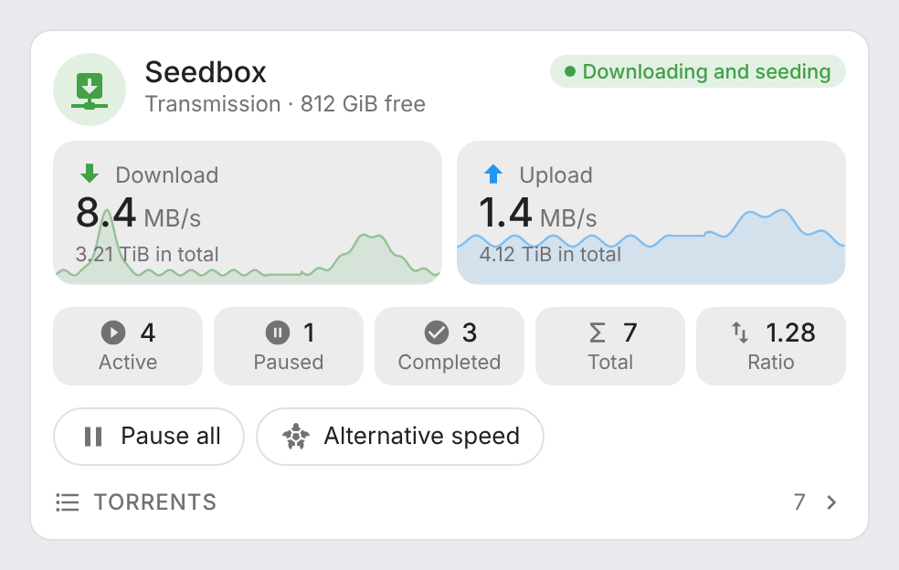 | 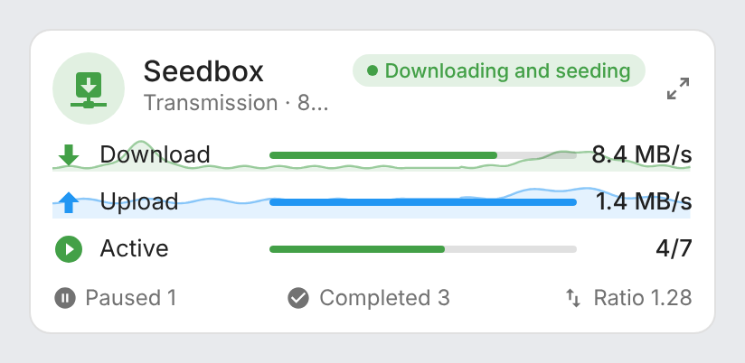 |

## Features

- Two cards: a full **Seedbox Card** and a compact **Seedbox Mini Card**
- Automatic discovery of the Transmission, qBittorrent and Deluge clients (several of each supported, and mixed)
- Download (green) and upload (blue) speeds, with the qBittorrent speed limits or the total transferred
- Speeds over the last 24 hours, drawn behind the speed tiles and, on the mini card, behind the speed rows, on a real time axis: missing data shows as a gap; their lowest and highest values in the tooltip
- Header status: idle, downloading, seeding, or both; qBittorrent's connection when it is firewalled or disconnected
- Torrent counters: active, downloading, seeding, paused, inactive, completed, errors (in red), total, and the global ratio
- Resume all / pause all (Transmission, Deluge; pausing asks for confirmation) and alternative speed (Transmission's turtle mode, qBittorrent) buttons
- Torrents list (Transmission, qBittorrent) with progress, status, time left and ratio, a search field (filters by name), torrents in error first; resume / pause of each Transmission torrent (pausing asks for confirmation)
- Free space of the download folder in the subtitle (Transmission)
- Click any value to open its Home Assistant history (more-info dialog)
- Detail button at the top right of the mini card: it switches to the full card and back, the full card's sections being set on the mini card too (visual editor included); a click anywhere outside the card brings the compact view back
- Visual editor in the dashboard UI for both cards (no YAML needed)
- Light and dark mode; English, French, German, Spanish, Serbian (Cyrillic and Latin), Italian, Dutch, European Portuguese, Polish, Romanian, Danish, Swedish, Bulgarian, Russian, Ukrainian, Hungarian, Slovak, Czech, Slovenian, Latvian and Greek
- Single file, no external dependency

## Supported integrations

| Integration | What the cards show |
|---|---|
|  [Transmission](https://www.home-assistant.io/integrations/transmission/) (built in) | Status, speeds and totals transferred, free space, active, paused, completed and total torrents, ratio, resume / pause all, turtle mode, torrents list with resume / pause. Details in [Transmission](#transmission) |
|  [qBittorrent](https://www.home-assistant.io/integrations/qbittorrent/) (built in) | Status and connection, speeds and their limits, active, inactive, paused, errored and total torrents, ratio, alternative speed, torrents list (read only). Details in [qBittorrent](#qbittorrent) |
|  [Deluge](https://www.home-assistant.io/integrations/deluge/) (built in) | Status, speeds, downloading and seeding torrents, resume / pause all. Details in [Deluge](#deluge) |

Several clients are supported, and they can be mixed: each one shows in the editor's client list.

## Prerequisites

Home Assistant 2024.8 or later, and the [Transmission](https://www.home-assistant.io/integrations/transmission/), [qBittorrent](https://www.home-assistant.io/integrations/qbittorrent/) or [Deluge](https://www.home-assistant.io/integrations/deluge/) integration (all built into Home Assistant), installed and configured.

## Installation

### Via the Marketplace (recommended)

Click the button below to add the repository directly:

[](https://my.home-assistant.io/redirect/marketplace_repository/?owner=juju35&repository=ha-seedbox-card&category=plugin)

Then click **Install**, and reload your browser when the Marketplace asks you to.

Or manually:

1. Open **Settings → Marketplace → Add from link** (top right; this needs a GitHub account connected)
2. Add `https://github.com/juju35/ha-seedbox-card` — Type: **Dashboard**
3. Open **Seedbox Card** and click **Install**
4. Clear your browser cache and refresh

### Manual

1. Download `seedbox-card.js` and the `seedbox-card.i18n.*.js` translation files from the [latest release](https://github.com/juju35/ha-seedbox-card/releases/latest)
2. Copy them all to `/config/www/` (without the translation files, the cards show in English)
3. Go to **Settings → Dashboards → ⋮ → Resources** → Add resource:
   - URL: `/local/seedbox-card.js`
   - Type: **JavaScript Module**
4. Clear your browser cache and refresh

## Configuration

### Visual editor

Edit a dashboard, click **Add card** and search for **Seedbox Card** or **Seedbox Mini Card**. The first client is preselected; pick another one in the list if you have several, set an optional title, choose the sections to display and the language. The preview updates live, and options left at their default are kept out of the generated YAML.

### Minimal

```yaml
type: custom:seedbox-card
```

```yaml
type: custom:seedbox-mini-card
```

### Full options

```yaml
type: custom:seedbox-card
client: Seedbox
title: Seedbox
url: http://192.168.1.10:9091
show_title: true
show_subtitle: true
show_speeds: true
show_history: true
show_counts: true
show_controls: true
show_torrents: true
expand_torrents: false
language: fr
```

```yaml
type: custom:seedbox-mini-card
client: Seedbox
title: Seedbox
url: http://192.168.1.10:9091
show_history: true
show_footer: true
zoom: true
show_speeds: true
show_counts: true
show_controls: true
show_torrents: true
expand_torrents: false
language: fr
```

### Options reference

| Option | Card | Default | Description |
|---|---|---|---|
| `client` | both | First client | Torrent client to display: its device name (as shown in Home Assistant) or its device id (set by the visual editor) |
| `title` | both | Client name | Card title |
| `show_title` | both | `true` | Show the title in the header (e.g. `false` under a section heading of your own) |
| `show_subtitle` | both | `true` | Show the subtitle (client, free space) under the title |
| `url` | both | Detected | Address opened in a new tab when clicking the header icon. Defaults to the web UI known by the integration (Deluge), else the client's website |
| `show_speeds` | both | `true` | Download and upload speed tiles |
| `show_history` | both | `true` | Speeds of the last 24 hours, from the recorder's history averaged over 5-minute periods, placed on a 24 h time axis with a gap where data is missing. Full card: behind the speed tiles; mini card: behind the speed rows |
| `show_counts` | both | `true` | Torrent counters and global ratio |
| `show_controls` | both | `true` | Resume all / pause all and alternative speed buttons, and the resume / pause button of each Transmission torrent |
| `show_torrents` | both | `true` | Torrents list (Transmission and qBittorrent) |
| `expand_torrents` | both | `false` | Torrents list expanded when the card loads (click the section title to fold / unfold) |
| `show_footer` | mini | `true` | Torrent counters, ratio and alternative speed in the footer |
| `zoom` | mini | `true` | Detail button at the top right: switches to the full card and back (`false` removes it). The full card's options (`show_speeds`, `show_counts`, `show_controls`, `show_torrents`, `expand_torrents`) can be set on the mini card too, in YAML or in its visual editor, and apply to that full view |
| `language` | both | Auto | Force language: `en`, `fr`, `de`, `es`, `sr`, `sr-Latn`, `it`, `nl`, `pt`, `pl`, `ro`, `da`, `sv`, `bg`, `ru`, `uk`, `hu`, `sk`, `cs`, `sl`, `lv` or `el` (auto-detects from HA settings) |

## Transmission

| Card | Transmission |
|---|---|
| Header | Status, free space of the download folder |
| Speed tiles | Download and upload speeds, total downloaded and uploaded |
| Counters | Active, paused, completed and total torrents, total ratio |
| Buttons | **Switch** (resume / pause all) and **Turtle mode** (alternative speed) |
| Torrents list | The `torrent_info` attribute of the **Total torrents** sensor; resume / pause through the `transmission.start_torrent` and `transmission.stop_torrent` actions |

The list shows as many torrents as the integration's **Limit** option allows (10 by default, in the integration's options, with their order).

## qBittorrent

| Card | qBittorrent |
|---|---|
| Header | Status; the connection status instead when it is firewalled (orange) or disconnected (red) |
| Speed tiles | Download and upload speeds and their limits (no limit: the total transferred) |
| Counters | Active, inactive, paused, errored and total torrents, global ratio |
| Buttons | **Alternative speed** |
| Torrents list | The `qbittorrent.get_torrents` action, read when the list is opened and again every minute while it stays open |

The integration has no action to resume or pause a torrent: the list is read only, and there is no resume all / pause all button. Some of its sensors are disabled by default (speed limits, totals, ratio): enable them in Home Assistant to show them.

| Light | Dark |
|---|---|
| 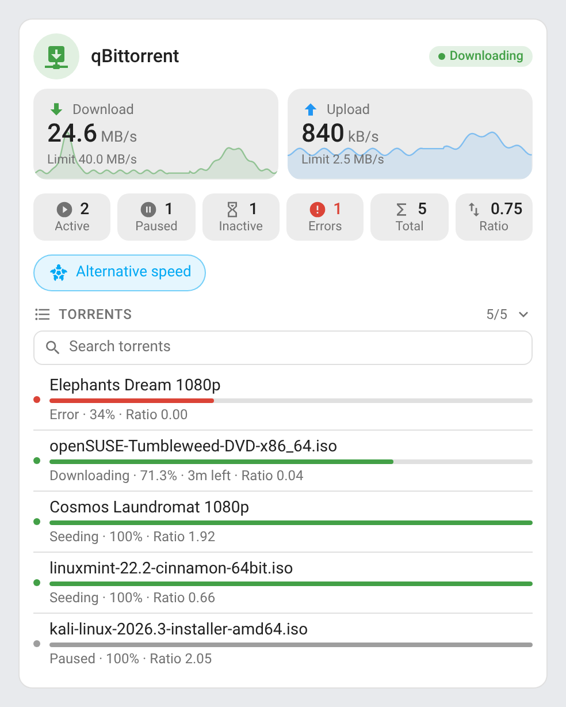 | 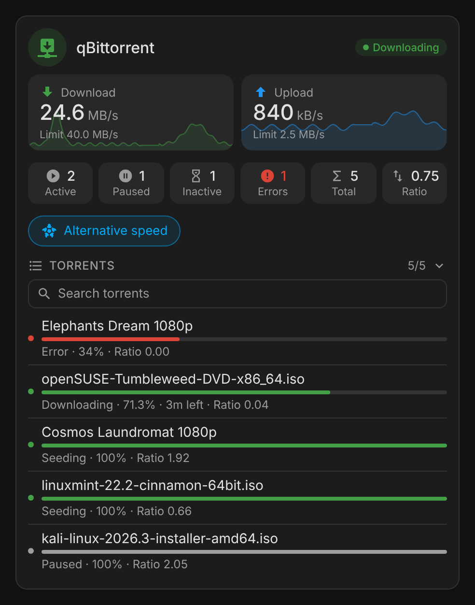 |
| 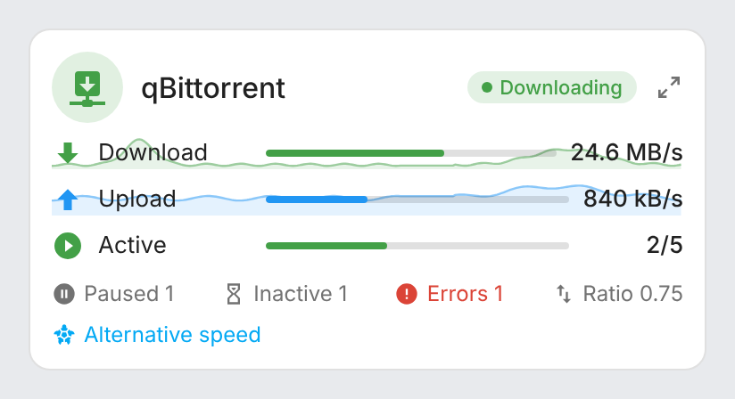 | 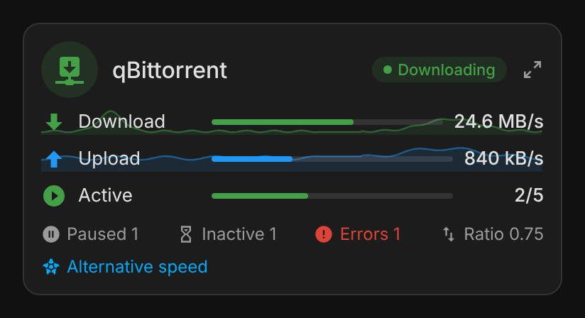 |

## Deluge

| Card | Deluge |
|---|---|
| Header | Status; the icon opens the Deluge web UI |
| Speed tiles | Download and upload speeds |
| Counters | Downloading and seeding torrents |
| Buttons | The integration's switch (resume / pause all) |

Deluge exposes no torrent list nor alternative speed in Home Assistant: those parts are left out.

| Light | Dark |
|---|---|
| 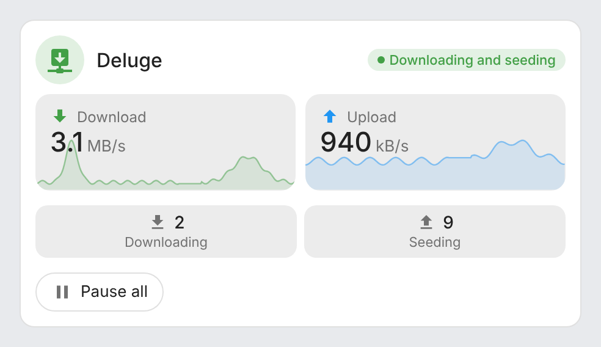 | 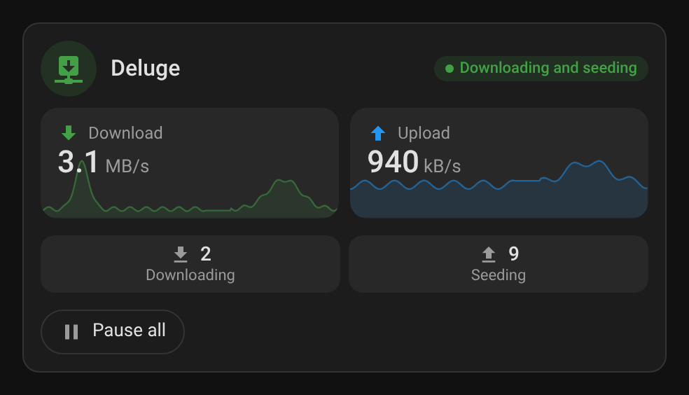 |
| 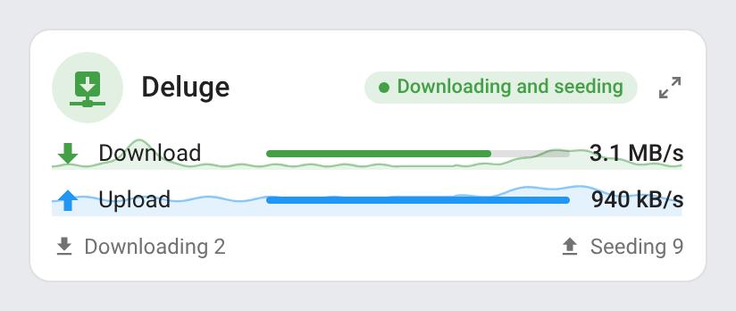 | 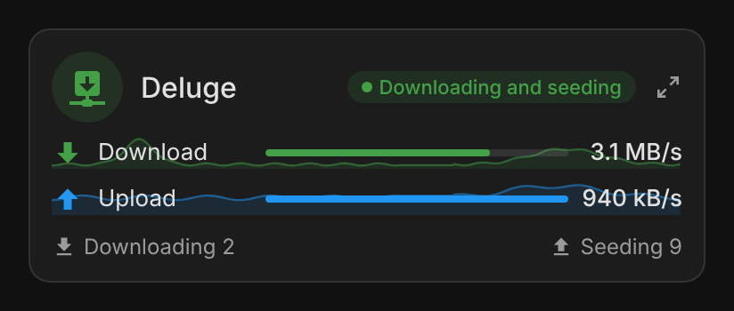 |

## Screenshots

| Light | Dark |
|---|---|
|  | 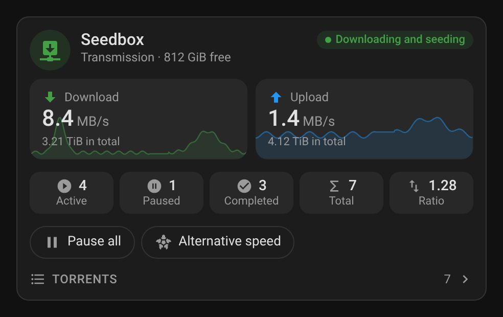 |
|  | 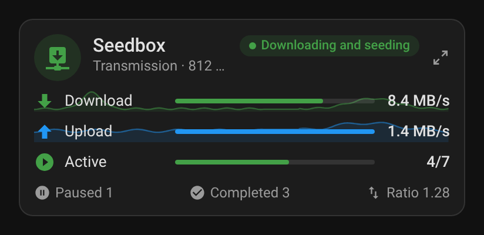 |
| 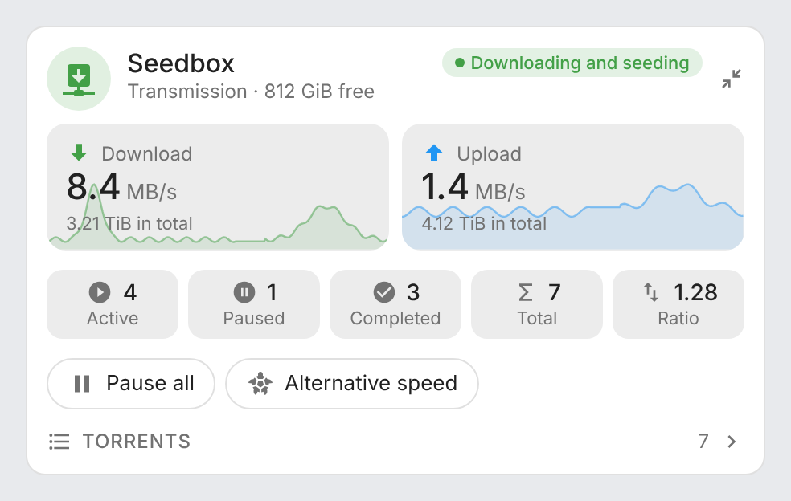 | 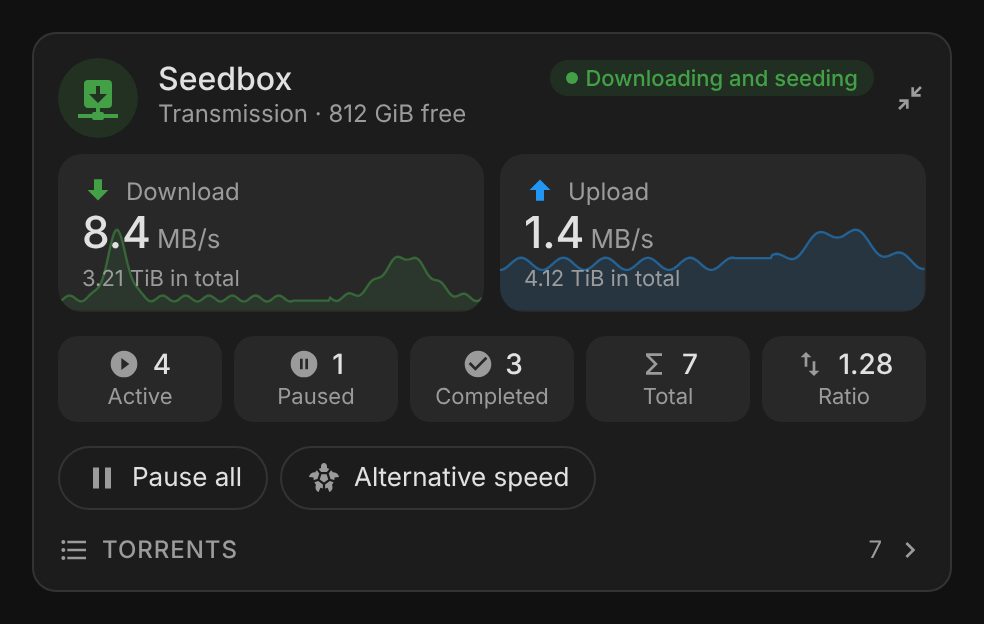 |

Torrents list (`expand_torrents: true`):

| Light | Dark |
|---|---|
| 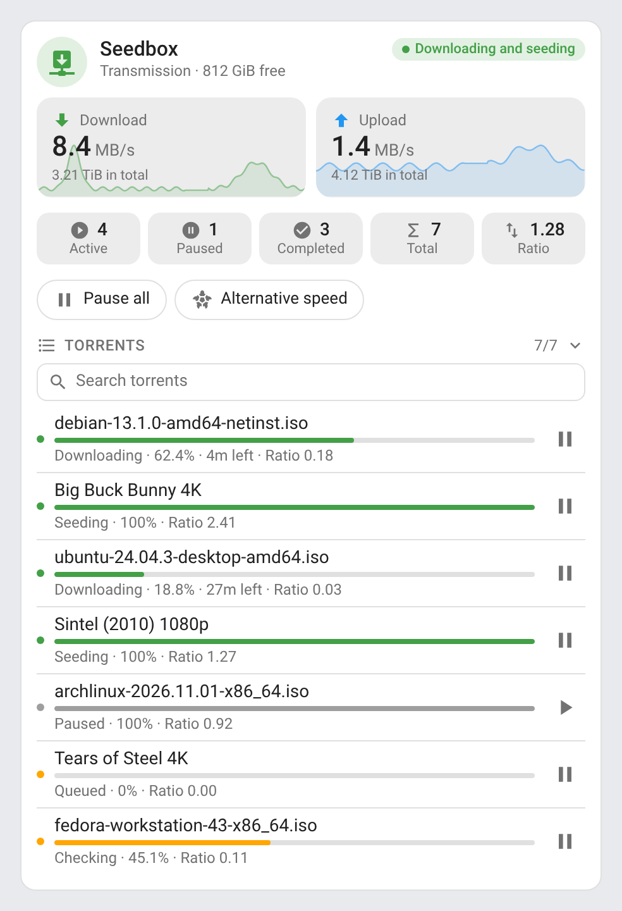 | 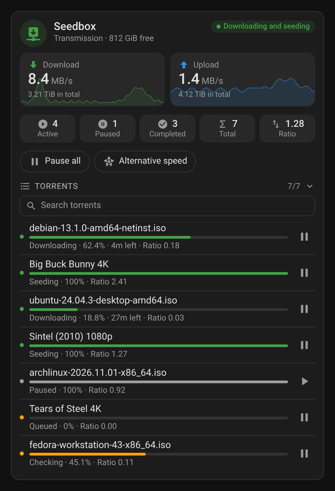 |

### Animations

| Animation | Light | Dark |
|---|---|---|
| Folding the torrents list | 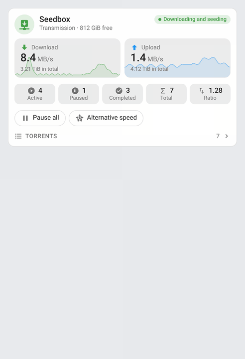 | 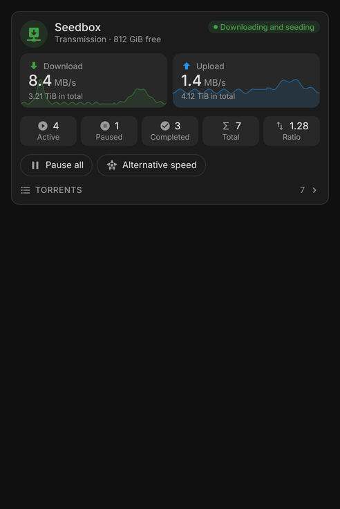 |
| Live speed bars | 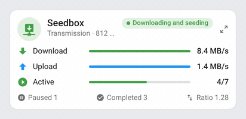 | 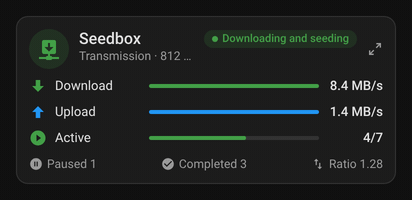 |
| Alternative speed | 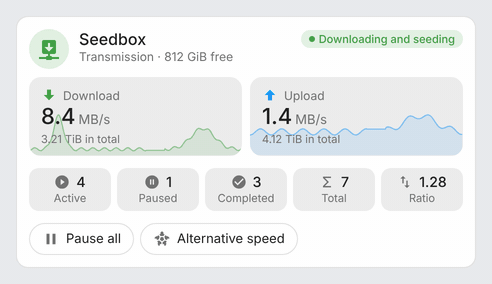 | 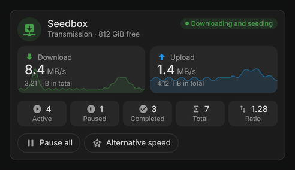 |
| Mini card detail button | 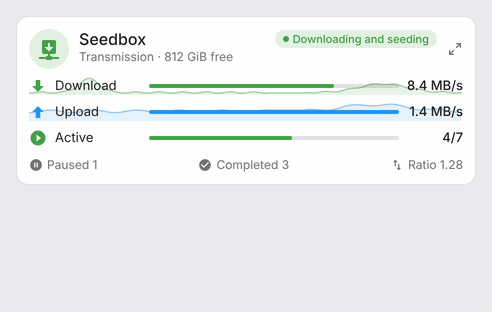 | 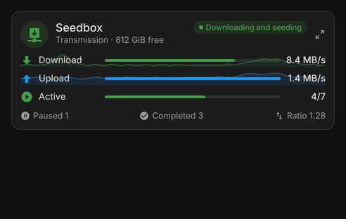 |

- `card-torrents.gif` / `card-torrents-dark.gif` — the torrents list folds and unfolds on a click on its title, with the chevron rotating along.
- `mini-card-speeds.gif` / `mini-card-speeds-dark.gif` — the download and upload bars follow every speed change with a smooth transition.
- `card-alt-speed.gif` / `card-alt-speed-dark.gif` — the alternative speed button takes the accent colour while it is on.
- `mini-card-zoom.gif` / `mini-card-zoom-dark.gif` — the detail button switches the mini card to the full card and back.

## How it works

The cards read the Home Assistant entity and device registries instead of entity ids: every entity of the Transmission, qBittorrent and Deluge integrations is matched by its `translation_key` (`download_speed`, `active_torrents`, `turtle_mode`…) and grouped by the client's device. Entity ids can therefore be in any language or renamed without breaking the cards.

Speeds are shown in decimal units (`kB/s`, `MB/s`, one decimal under 100) whatever unit Home Assistant displays them in; sizes in binary units (`GiB`, `TiB`). The speed sensors have no long-term statistics, so the 24 h curves come from the recorder's history, averaged over 5-minute periods and fetched again every 5 minutes. On the mini card, a speed bar is scaled on the speed limit (qBittorrent), else on the highest speed of the last 24 hours.

Pausing every torrent or a single torrent asks for confirmation, in a popup at the top of the card; resuming and switching the alternative speed act at once.

## Development

```bash
npm install
npm run build        # bundles src/seedbox-card.js into dist/seedbox-card.js
npm run check        # builds and checks the card (run in CI)
npm test             # unit tests, and the layout test in Chromium (CHROMIUM_PATH to use an installed browser)
npm run screenshots  # renders the cards with mock data (scripts/mock-states.mjs) into screenshots/, PNG and animated GIF (needs ffmpeg)
```

The **Screenshots** workflow re-renders `screenshots/` on every pull request touching `src/`, `scripts/`, `images/` or `package-lock.json` (a Playwright/Chromium bump changes the rendering) and commits the refreshed captures onto the pull request's branch, so the README always matches the code.

`dist/` is not committed: `npm run build` creates it locally, CI builds it on every push, and the release workflow attaches the built files to the release, which is where the Marketplace installs them from.

### Releasing

1. Bump `version` in `package.json`
2. Add a `## <version>` section at the top of [CHANGELOG.md](https://github.com/juju35/ha-seedbox-card/blob/main/CHANGELOG.md)
3. Push to `main`: the **Release** workflow builds the card, creates the tag and the GitHub release with the changelog section as notes, and attaches `seedbox-card.js` and its translation files

## Translations

The cards auto-detect the language from your Home Assistant settings. Currently supported:

| Language | Code |
|---|---|
| English | `en` |
| Français | `fr` |
| Deutsch | `de` |
| Español | `es` |
| Српски | `sr` |
| Srpski (latinica) | `sr-Latn` |
| Italiano | `it` |
| Nederlands | `nl` |
| Português (European) | `pt` |
| Polski | `pl` |
| Română | `ro` |
| Dansk | `da` |
| Svenska | `sv` |
| Български | `bg` |
| Русский | `ru` |
| Українська | `uk` |
| Magyar | `hu` |
| Slovenčina | `sk` |
| Čeština | `cs` |
| Slovenščina | `sl` |
| Latviešu | `lv` |
| Ελληνικά | `el` |

Contributions for additional languages are welcome!

## Credits

[Transmission](https://transmissionbt.com), [qBittorrent](https://www.qbittorrent.org) and [Deluge](https://deluge-torrent.org) are projects of their own communities, with their Home Assistant integrations in Home Assistant core.

## License

[MIT](https://github.com/juju35/ha-seedbox-card/blob/main/LICENSE)

## Support

If you find this project useful, you can support its development:

<a href="https://buymeacoffee.com/julienstep9"></a>
